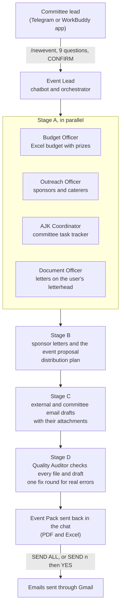

# Orkesta AI

**An AI event committee for student organisers, built on Tencent WorkBuddy.**

Orkesta AI is a team of WorkBuddy experts that does the paperwork behind a student event. The committee lead chats with it on Telegram (or in the WorkBuddy app), answers a few questions about the event, uploads the committee list and the organisation's letter templates, and gets back a checked Event Pack: the event proposal, official letters on their own letterhead, an Excel budget, sponsor and caterer contacts, a committee task tracker, and email drafts for every party involved. Nothing is emailed until the user approves it.

Built for **DORMATHON 2026, Track 2: Agentic Solution**.

---

## Contents

- [The problem](#the-problem)
- [What Orkesta AI does](#what-orkesta-ai-does)
- [How it works](#how-it-works)
- [The experts](#the-experts)
- [Two ways to run it](#two-ways-to-run-it)
- [Repository structure](#repository-structure)
- [Setup](#setup)
- [Using the chatbot](#using-the-chatbot)
- [Safety and approvals](#safety-and-approvals)
- [Known limitations](#known-limitations)
- [Built with](#built-with)

---

## The problem

Student committees in Malaysia (called *AJK*, short for *ahli jawatankuasa*) run most campus events, and every event has to pass a strict approval process before it can happen:

- At Universiti Islam Selangor, a society's full proposal must reach the student affairs office **40 working days** before the event and go through about **ten approval steps**, including roughly 30 working days with the bursar. [1]
- At USIM, proposals are presented at only **six sessions a year**, and late or incomplete proposals are not accepted. [2]

One wrong date, a budget that doesn't add up, or a letter in the wrong format can send a proposal back and push the event out. All of this work is done by students, unpaid, on top of a full course load. Event coordinator ranked fifth on CareerCast's list of the most stressful jobs in both 2016 and 2017 [3], and a 2024 study of Malaysian university students found stress symptoms in 86.3% of those surveyed [4].

In practice the paperwork lands on two or three committee members: the event proposal (*kertas kerja*), the budget, official letters (*surat rasmi*) in the university's format, access requests to campus security, sponsor and caterer outreach, and chasing everyone else about their tasks. The rest of the committee is often unsure which files, tasks and deadlines are theirs.

## What Orkesta AI does

One conversation produces a complete Event Pack:

| Output | Format | Made by |
|---|---|---|
| Event proposal (*kertas kerja*), following an approved proposal the user uploads, or a standard format | PDF + DOCX | Document Officer |
| Official letters (venue booking, amendment, VIP invitation, sponsorship, thank-you), on the user's own letterhead | PDF + DOCX | Document Officer |
| Budget with income, prizes, expenses, allocation and summary sheets, all live formulas, with an over-budget check and rebalancing | XLSX | Budget Officer |
| Sponsor, prize-sponsor and halal caterer contacts, each with its source link | XLSX | Outreach Officer |
| Committee task tracker counted back from the event date, with each task assigned by position | XLSX | AJK Coordinator |
| Distribution plan: which files and tasks go to which committee member | XLSX | AJK Coordinator |
| Email drafts: access request to security, sponsorship and quotation requests, and one email per committee member with only their own files and tasks attached | Gmail drafts | Outreach Officer, AJK Coordinator, Gmail Assistant |
| QA report and a one-page Event Pack summary | PDF | Quality Auditor, Event Lead |

Every email follows a formal Malaysian structure (*Salam sejahtera*, the recipient's honorific, the date, time and venue block, the purpose, the attachments, and a full signature block), with no emojis or filler.

## How it works



1. **Intake.** The Event Lead asks nine questions, one at a time, and checks each answer as it comes in: program and organiser, letter templates (PDF uploads), date and time, venue, participants, budget and its sources, the committee list, prizes, and which letters are needed with the template for each. It then asks a few follow-ups only when needed: recipients and their honorifics, the security office email, amendment details, and the signature block.
2. **Confirm.** It shows one summary with the defaults it will use. Nothing is generated until the user replies `CONFIRM`.
3. **Run.** It saves the confirmed brief as the single source of truth and runs the team in four stages. Members only report back to the Event Lead; they never message the user or each other.
4. **Deliver.** The Event Pack comes back in the chat, with the QA verdict, the list of committee emails and the numbered external drafts.
5. **Approve.** `SEND ALL` emails each committee member their files and tasks. `SEND n` followed by `YES` sends one external email. A change such as a new venue updates only the affected files, and `SEND UPDATES` notifies only the affected members.

The Event Lead keeps its progress in a small memory file, so a chat that restarts picks up at the right step.

## The experts

The six custom experts are in this repository. Gmail Assistant and Drive Finder are existing WorkBuddy experts that the Event Lead calls; they are not included here.

| Expert | Malay role | What it does |
|---|---|---|
| [`aiajk-event-lead`](experts/aiajk-event-lead) | Pengarah Program | The chatbot. Runs the intake, confirms the brief, dispatches the team, delivers the Event Pack, and handles approvals and changes. |
| [`aiajk-document-officer`](experts/aiajk-document-officer) | Setiausaha | Writes the event proposal and official letters. Copies the letterhead from the user's PDF template as an image and follows its layout. |
| [`aiajk-budget-officer`](experts/aiajk-budget-officer) | Bendahari | Builds the formula-driven Excel budget with a prizes sheet, a 10% contingency and an over-budget check, and rebalances if needed. |
| [`aiajk-outreach-officer`](experts/aiajk-outreach-officer) | Biro Perhubungan dan Tajaan | Finds sponsors, prize sponsors and halal caterers from published business contacts, and writes the external emails. |
| [`aiajk-ajk-coordinator`](experts/aiajk-ajk-coordinator) | Penyelaras AJK | Builds the task tracker from the committee list, decides who gets which files, and writes one email per committee member. |
| [`aiajk-quality-auditor`](experts/aiajk-quality-auditor) | Juruaudit | Checks every file and draft against the confirmed brief: facts, formulas, letterheads, email format and attachments. |
| Gmail Assistant (`gmail-assistant`) | | Existing WorkBuddy expert. Creates and verifies Gmail drafts and sends them only after approval. |
| Drive Finder (`google-drive-finder`) | | Existing WorkBuddy expert. Finds templates and source files in Google Drive. |

## Two ways to run it

The repository contains two versions of the committee.

| | AI AJK experts (`aiajk-*`) | Event Committee Team (`event-committee-lead`) |
|---|---|---|
| Packaging | Six separate agent experts, led by `aiajk-event-lead` | One team expert: a lead (Ke) and six officers |
| Members | Document, Budget, Outreach, AJK Coordinator, Quality Auditor, plus Gmail Assistant and Drive Finder | Event Director, Budget Officer, Outreach Officer, Task Coordinator, Quality Auditor, Secretary |
| Letter templates | User uploads PDF templates (T1, T2, ...); one template can serve several letters | A/B/C system: the user's Word template, a template library, or the standard format |
| Extras | Google Drive search through Drive Finder | Event concept and risk planning, meeting minutes and decision logs, preset workflows (full planning, budget review, outreach campaign, progress audit, meeting preparation), `UPLOAD ALL` to Google Drive, `TELEGRAM n` to send a file |
| External tools | Gmail Assistant, Drive Finder, a Telegram file helper | MCP servers: `gmail`, `gmail-file-sender`, `telegram-file-sender`, `google-drive` |

## Repository structure

```
experts/
  aiajk-event-lead/              Event Lead (chatbot and orchestrator)
  aiajk-document-officer/        Document Officer
  aiajk-budget-officer/          Budget Officer
  aiajk-outreach-officer/        Outreach Officer
  aiajk-ajk-coordinator/         AJK Coordinator
  aiajk-quality-auditor/         Quality Auditor
  event-committee-lead/          Event Committee Team (lead + six officers in agents/)
```

Each expert folder follows the WorkBuddy expert package format:

```
<expert>/
  .codebuddy-plugin/plugin.json  Expert metadata: names, description, category, quick prompts
  agents/<expert>.md             The agent's instructions
  avatars/                       Avatar image
  manifest.yaml                  Package manifest
  README.md                      Expert summary
```

The Event Committee Team has no generated avatars yet; `experts/event-committee-lead/avatars/AVATAR_PROMPTS.md` contains the prompts to create them.

## Setup

### 1. Install the experts

1. Install [Tencent WorkBuddy](https://www.workbuddy.ai) on the computer that will run the bot.
2. Clone this repository.
3. Copy the expert folders you want into your WorkBuddy experts directory:
   - Windows: `%USERPROFILE%\.workbuddy-ai\plugins\marketplaces\my-experts\plugins\`
   - macOS: `~/.workbuddy-ai/plugins/marketplaces/my-experts/plugins/`
4. Restart WorkBuddy or refresh the expert list. If an expert does not appear, ask WorkBuddy's expert-manager to register it.
5. For the AI AJK version, add Gmail Assistant and Drive Finder from WorkBuddy, then create an expert team with `aiajk-event-lead` as the lead.

### 2. Connect the tools

- **Skills:** Tencent Docs (`tencent-docx`, `tencent-docs-sheet-generation`, `tencent-docs-sheetagent`, `tencent-docs-routing`), `pdf`, and `agent-browser` for the Outreach Officer.
- **Gmail:** connect the Gmail account that will send the emails.
- **Telegram:** create a bot with @BotFather and connect it in WorkBuddy's Assistant settings. The computer must stay on with WorkBuddy open for the bot to reply.
- **Event Committee Team only:** configure the MCP servers it expects: `gmail`, `gmail-file-sender`, `telegram-file-sender` and `google-drive`. They are not included in this repository.

### 3. Create the project folder

The AI AJK Event Lead works inside one project folder:

```
<project-folder>/
  inputs/                 Committee lists and uploads
  inputs/templates_user/  The user's letter templates (saved as T1_..., T2_...)
  tools/                  Helpers, such as the Telegram file sender
  chatbot/                The Event Lead's memory (session_state.md)
  output/<event-slug>/    One folder per event
```

Open `experts/aiajk-event-lead/agents/aiajk-event-lead.md` and replace the two `[PASTE ...]` lines under `PROJECT FOLDER` with your folder's full path and, optionally, a Google Drive share link.

Each event gets its own folder:

```
output/<event-slug>/
  00_brief/       Confirmed event brief and plan (internal)
  01_proposal/    Event proposal (PDF, DOCX)
  02_budget/      Budget (XLSX)
  03_letters/     Official letters (PDF, DOCX)
  04_outreach/    Contacts and email draft log (XLSX)
  05_ajk/         Task tracker and distribution plan (XLSX)
  06_qa/          QA report (PDF)
  EVENT_PACK_SUMMARY.pdf
```

## Using the chatbot

| Command | What it does |
|---|---|
| `/start`, `/help` | Shows what Orkesta AI prepares and the commands |
| `/newevent` | Starts the nine-question intake |
| `/status` | Days to go, progress, next deadlines and anything waiting for you |
| `/files` | Sends the Event Pack files again, or only the one you name |
| `/drafts` | Lists the external email drafts and their status |
| `/cancel` | Stops the intake, or stops the run after the current stage |
| `EDIT n` | Changes the answer to question n |
| `CONFIRM` | Starts the team on the confirmed details |
| `SEND ALL` | Emails every committee member their files and tasks (`SEND ALL EXCEPT 3, 7` skips people) |
| `SEND n`, then `YES` | Sends one external email |
| `DONE n` | Marks task n as done in the tracker |
| `SEND UPDATES` | After a change, emails only the members it affects |
| `CONTINUE` | Resumes a run that stopped |

A shortened example:

```
You:  /newevent
Bot:  Question 1 of 9. What is the program name, and which club or college is organising it?
You:  Malam Apresiasi Kolej Cempaka 2026, by JPK Kolej Cempaka
Bot:  Question 2 of 9. Please upload your letter templates as PDF, with your letterhead.
      You can send several. Reply DONE when finished.
...
Bot:  Event Pack ready: Malam Apresiasi Kolej Cempaka 2026, D-41
      [proposal PDF, letters, budget, contacts, task tracker]
      QA: READY WITH NOTES
      10 committee emails ready. Reply SEND ALL to send them.
      External drafts: 1. Security office  2-4. Sponsors  5-6. Caterers. Reply SEND n.
You:  SEND 1
Bot:  To: security office | Subject: PERMOHONAN KEBENARAN AKSES ... | Attachment: letter PDF
      Reply YES to send.
```

## Safety and approvals

- **No email without approval.** Every email stays a draft until the user replies `SEND ALL`, `SEND UPDATES`, or `SEND n` followed by `YES`.
- **No invented facts.** Names, emails, phone numbers, prices, dates, reference numbers and approvals come only from the confirmed brief, the user's files or a cited source. Anything missing is marked `[TBC]` and asked about.
- **Public business contacts only.** The Outreach Officer records only contact details that businesses publish themselves, each with its source link, and never guesses an email address.
- **Independent check.** The Quality Auditor reviews every file and draft before anything reaches the user.
- **No credentials in the instructions.** Bot tokens and API keys stay in local settings, never in the agent files.

## Known limitations

- The Telegram bot and all agents run on the WorkBuddy desktop app, so the computer must be on and WorkBuddy open.
- Sending files back through Telegram needs a helper (`tools/`) or the `telegram-file-sender` MCP server; WorkBuddy's built-in Telegram assistant does not send files by itself.
- Daily reminders need a separate WorkBuddy automation, which is not included in this repository.
- Gmail Assistant, Drive Finder and the MCP servers used by the Event Committee Team are external and must be set up separately.
- A full six-expert run uses a noticeable amount of WorkBuddy credits; test individual experts with small inputs first.

## Built with

- [Tencent WorkBuddy](https://www.workbuddy.ai): Expert Center, expert teams, skills, connectors and the Assistant (Telegram)
- Tencent Docs skills for Word, Excel and PDF output
- Gmail and Google Drive through WorkBuddy experts and MCP servers
- Telegram Bot API

## Sources

1. Universiti Islam Selangor, [society program approval process](https://www.uis.edu.my/images/bpm/saksr/proses-kerja/kelulusan-program-persatuan.pdf)
2. USIM Student Affairs, [2025 proposal submission and presentation schedule](https://hep.usim.edu.my/wp-content/uploads/2025/10/Takwim-Penghantaran-dan-Sesi-Pembentangan-Kertas-Kerja-1.pdf)
3. Northstar Meetings Group, [2017 Most Stressful Jobs list has event coordinators at No. 5](https://www.northstarmeetingsgroup.com/Career-Development/Career-Advice/2017-Most-Stressful-Jobs-List)
4. Halim et al. (2024), [Depression, anxiety, stress and coping strategies among Malaysian university students](https://ojs.amhinternational.com/index.php/imbr/article/view/4308)

## License

Released under the MIT License.
